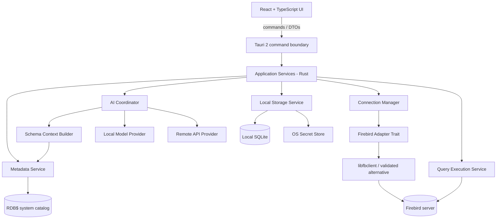

# Firebird Studio Linux — Especificação Técnica e Arquitetura

**Versão do documento:** 0.1  
**Data:** 14/10/2026  
**Status:** proposta inicial para validação técnica  
**Tipo de produto:** IDE desktop open source para Firebird com assistência de IA contextual  
**Plataforma inicial:** Linux x86_64, com foco em Linux Mint e Ubuntu  
**Licença proposta:** Apache-2.0, sujeita à revisão das licenças das dependências e redistribuição do cliente Firebird

---

## 1. Resumo executivo

O Firebird Studio Linux será uma IDE desktop para conectar e administrar bancos Firebird, escrever e executar SQL, explorar metadados e gerar consultas com assistência de IA. O produto será projetado para funcionar com bancos Firebird a partir da linha 2.0, incluindo 2.1, 2.5, 3.0, 4.0 e 5.0, dentro de uma matriz de compatibilidade publicada e testada.

O MVP deve priorizar quatro capacidades integradas:

1. Gerenciador de conexões Firebird.
2. DB Explorer com objetos e metadados do banco.
3. SQL Editor com execução controlada e grade de resultados.
4. Assistente de IA que gera e explica SQL a partir do esquema real da conexão ativa.

A IA será configurável para usar provedores locais ou APIs externas. O conteúdo enviado a um provedor remoto deverá ser mostrado e controlado pelo usuário; por padrão, não serão enviados registros de negócio, senhas ou strings de conexão.

A arquitetura proposta utiliza Tauri 2, React, TypeScript e CodeMirror 6 na interface, com serviços de domínio em Rust e um adaptador isolado para a API cliente do Firebird. A persistência das preferências e do histórico será local, usando SQLite. As primeiras entregas serão Linux x86_64; outras arquiteturas/distribuições serão adicionadas após validação.

> **Risco técnico prioritário:** a compatibilidade real com Firebird 2.0/2.1 no Linux moderno não deve ser presumida. A primeira entrega de engenharia é uma prova de conceito de conexão, leitura de metadados e execução de SQL contra cada versão mínima exigida.

## 2. Decisões já confirmadas

| Tema | Decisão |
|---|---|
| SGBD | Somente Firebird; InterBase está fora do escopo inicial |
| Versão mínima | Firebird 2.0; incluir 2.1, 2.5 e versões posteriores homologadas |
| Sistema operacional | Linux; primeira meta de distribuição: Linux Mint/Ubuntu x86_64 |
| Tipo de aplicação | Desktop, não aplicação web hospedada |
| IA | Provedores locais e APIs externas configuráveis |
| MVP | SQL Editor, DB Explorer, resultados e IA contextual |
| Código-fonte | Open source |
| Método de engenharia | TDD, critérios de aceite e testes de integração por versão |

## 3. Objetivos

### 3.1 Objetivos funcionais

- Registrar, testar, abrir e fechar conexões Firebird locais ou remotas.
- Navegar por bancos, tabelas, campos, views, índices, chaves, procedures, triggers, generators/sequences, domínios e constraints, conforme a versão e permissões.
- Executar uma instrução ou seleção SQL e apresentar resultados, metadados de colunas, erros e duração.
- Manter múltiplas abas SQL, histórico local e scripts salvos.
- Gerar SQL em linguagem natural com contexto de metadados do banco ativo.
- Explicar SQL existente e sugerir correções quando houver erro.
- Permitir revisão e edição humana antes de qualquer execução de SQL gerado pela IA.
- Identificar a versão do servidor e adaptar consultas de catálogo e recursos disponíveis.
- Funcionar sem conexão à internet quando o usuário usar um provedor local e a dependência Firebird correspondente estiver instalada.

### 3.2 Objetivos não funcionais

- Isolar a interface da camada nativa de acesso ao banco.
- Evitar que falhas de conexão ou consultas demoradas travem a interface.
- Proteger credenciais usando o cofre de segredos do sistema sempre que disponível.
- Não executar automaticamente SQL gerado pela IA.
- Permitir testes automatizados sem banco real por meio de interfaces e adaptadores falsos.
- Documentar combinações testadas de cliente Firebird, servidor, arquitetura e distribuição Linux.
- Disponibilizar builds reproduzíveis, changelog, SBOM e política de reporte de vulnerabilidades.

### 3.3 Fora do escopo do MVP

- InterBase.
- Depurador visual de procedures/triggers.
- Modelador ERD completo e engenharia direta/reversa avançada.
- Assistentes completos de backup/restore e nbackup.
- OLAP, relatórios avançados e painel completo de monitoramento/Trace.
- Replicação, administração de servidores remotos, migração automática entre versões.
- Editor visual de tabelas com gravação de DDL no banco. No MVP, o foco é inspeção e SQL manual com assistência da IA.
- Envio automático de amostras de registros ao modelo.

Esses itens podem ser adicionados após o MVP, sem comprometer os contratos de domínio definidos neste documento.

## 4. Premissas de compatibilidade Firebird

### 4.1 Conceito de suporte

“Suportar Firebird 2.0+” significa que cada versão declarada como suportada passou por testes de integração para as funções incluídas na matriz. Não significa que todos os recursos de administração estarão disponíveis em todas as versões.

A documentação oficial lista Firebird 2.0, 2.1 e 2.5 como séries descontinuadas. Isso não impede conexões técnicas, mas implica risco de segurança e ausência de manutenção oficial; o produto deve sinalizar versões legadas e não sugerir que elas estejam seguras ou recebam correções.

### 4.2 Matriz inicial proposta

| Servidor | Objetivo do MVP | Critério |
|---|---|---|
| Firebird 2.0.x | Prioridade de prova de conceito | Conexão, versão, catálogo, SELECT, transação e erro |
| Firebird 2.1.x | Prioridade de prova de conceito | Mesmo conjunto básico; detectar recursos específicos |
| Firebird 2.5.x | Homologação do legado | Testes básicos e cobertura ampliada de metadados |
| Firebird 3.0.x | Homologação | Testes de conexão/autenticação e metadados |
| Firebird 4.0.x | Homologação | Tipos e recursos novos sem quebrar o catálogo comum |
| Firebird 5.0.x | Homologação | Testes da versão mais recente incluída no escopo inicial |

As versões 6.x ou posteriores não são parte do compromisso inicial; serão adicionadas após testes de regressão.

### 4.3 Biblioteca cliente

O adaptador deve suportar configuração explícita de localização e versão da biblioteca `libfbclient.so`. Não deve substituir bibliotecas do sistema nem criar links simbólicos globais automaticamente.

A aplicação deverá oferecer:

- Descoberta de bibliotecas em locais conhecidos e seleção manual do caminho.
- Validação da arquitetura e tentativa de carregamento isolada.
- Exibição do caminho e versão da biblioteca efetivamente carregada.
- Mensagem acionável quando a biblioteca estiver ausente, incompatível ou sem dependências.
- Capacidade de configurar bibliotecas clientes diferentes por perfil, se isso for tecnicamente viável.
- Registro da combinação servidor/cliente testada no relatório de diagnóstico.

Não presumir que uma única `libfbclient.so` será ideal para todas as versões antigas e modernas. A prova de conceito deverá avaliar pelo menos duas estratégias: uso da biblioteca nativa oficial e uso de uma implementação/protocolo alternativo em Rust, sem assumir antecipadamente que a alternativa suporta Firebird 2.0.

### 4.4 Dialeto, charset e versão

- Armazenar dialeto SQL (1 ou 3) no perfil da conexão ou solicitar confirmação quando não for possível determiná-lo com segurança.
- Configurar charset da conexão explicitamente, com UTF8 como padrão recomendado, permitindo alteração por conexão.
- Obter a versão do servidor por informação disponibilizada pela API e usar consulta de catálogo como fallback apenas quando aplicável.
- Não executar SQL específico de versões novas sem verificar a versão do servidor.
- Normalizar metadados para um modelo interno comum; campos não suportados devem ser representados como ausentes, e não inventados.
- Tratar identificadores entre aspas, nomes case-sensitive, caracteres nacionais e nomes com espaços.

## 5. Arquitetura de alto nível



### 5.1 Camadas

**Interface (React/TypeScript)**
- Exibe o estado e solicita operações através de comandos tipados.
- Não acessa diretamente o Firebird, arquivos arbitrários ou segredos.
- Não decide se SQL é seguro; apresenta a avaliação fornecida pelo backend e exige confirmação adequada.

**Fronteira Tauri**
- Expõe comandos explicitamente permitidos.
- Valida argumentos, limites, sessão ativa e permissões da operação.
- Aplica escopos mínimos às APIs Tauri; evitar permissões genéricas de filesystem/shell.

**Serviços de aplicação (Rust)**
- Orquestram sessões de banco, leitura de catálogo, execução, persistência, segurança e IA.
- Independem da interface para facilitar testes unitários.

**Domínio**
- Define modelos e contratos sem depender de Tauri, React ou provedores de IA.
- Contém regras para versão de servidor, normalização de metadados, classificação de operações e limites de execução.

**Adaptadores externos**
- Adaptador Firebird.
- Adaptadores para provedor local e API remota de IA.
- SQLite, cofre de segredos do SO e logging.

### 5.2 Stack proposta

| Área | Opção inicial | Observações |
|---|---|---|
| Desktop | Tauri 2 | Binário nativo e integração com frontend web |
| UI | React + TypeScript + Vite | Interface por funcionalidades |
| Editor SQL | CodeMirror 6 | Linguagem Firebird própria para realce/autocomplete; evitar assumir suporte completo pronto |
| Grades | TanStack Table + virtualização | Paginação e renderização de resultados grandes |
| Estado UI | Zustand ou Context API | Usar Zustand somente se o estado compartilhado justificar |
| Backend desktop | Rust | Serviços, acesso a banco, limites e persistência |
| Cliente Firebird | `libfbclient.so` carregada dinamicamente, se validada | Alternativa deve ser decidida após a prova de conceito |
| Persistência local | SQLite via crate Rust | Configuração, histórico e descrições locais |
| Segredos | Secret Service/libsecret ou keyring multiplataforma equivalente | Não armazenar senha em texto puro no SQLite |
| Testes UI | Vitest + Testing Library | Testes unitários e componentes |
| Testes Rust | `cargo test` | Domínio, serviços e adaptadores simulados |
| Testes de fluxo | Playwright ou testes equivalentes | Caminhos críticos da interface; validar integração com Tauri |
| Gestão de pacotes JS | pnpm | Pode ser alterado sem impacto na arquitetura |

A escolha do editor, driver e bibliotecas deve ser revisitada na prova de conceito. Nenhuma dependência de terceiros é declarada como comprovadamente compatível com Firebird 2.0 até a execução dos testes de integração.

## 6. Módulos do MVP

### 6.1 Gerenciador de conexões

**Requisitos**
- Criar, editar, duplicar, testar, conectar e desconectar perfis.
- Suportar conexão TCP/IP com host, porta, caminho/alias do banco, usuário, role opcional, charset e dialeto.
- Permitir conexão local somente se o adaptador e a instalação do cliente suportarem esse modo.
- Salvar nome do perfil, host, porta, banco, usuário, charset, dialeto, timeout e caminho opcional da biblioteca cliente.
- Salvar senha/tokens apenas no cofre de segredos do sistema.
- Separar claramente perfil salvo de sessão conectada.
- Exibir status: desconectado, conectando, conectado, reconectando ou erro.
- Oferecer um teste de conexão sem registrar o perfil automaticamente.

**Critérios de aceite**
- Uma conexão inválida exibe erro acionável sem travar a interface.
- Nenhum campo de senha aparece em logs, mensagens de erro ou histórico.
- O usuário pode escolher uma biblioteca cliente e ver qual biblioteca foi carregada.

### 6.2 DB Explorer

**Objetos mínimos**
- Banco e informações básicas da conexão.
- Tabelas e views.
- Campos e seus tipos efetivos, incluindo domínio, nulabilidade, default e posição.
- Chaves primárias, estrangeiras e únicas.
- Índices.
- Domínios.
- Procedures e parâmetros, quando suportados no catálogo da versão.
- Triggers e generators/sequences.
- Dependências de objetos, quando disponíveis.

**Comportamento**
- Busca por nome com debounce.
- Expansão sob demanda, sem carregar todos os detalhes de todos os objetos na primeira conexão.
- Atualização manual de um nó ou de toda a árvore.
- Menu contextual: copiar nome qualificado, abrir definição ou inserir nome no editor.
- Identificação visual de objetos de sistema versus objetos do usuário.
- Metadados respeitando os privilégios do usuário conectado.

**Regras**
- Consultas ao catálogo ficam centralizadas em `MetadataRepository`.
- SQL de catálogo deve ter variantes compatíveis e testes por versão.
- Normalizar espaços de preenchimento de campos `CHAR` vindos de `RDB$`.
- Não depender exclusivamente da análise textual de definições para inferir relações; usar constraints/catalog e indicar quando a relação for apenas uma sugestão heurística.

### 6.3 SQL Editor

**Capacidades do MVP**
- Abas múltiplas e estado não salvo claramente sinalizado.
- Realce de sintaxe para Firebird SQL/PSQL.
- Números de linha, localizar/substituir e indentação.
- Executar seleção ou instrução atual.
- Atalho configurável para executar.
- Mostrar duração, contagem de linhas e erro devolvido pelo servidor.
- Histórico consultável com data, conexão e estado do comando; permitir limpeza.
- Inserir nomes de objetos/campos pelo DB Explorer.
- Mensagens de erro com código, texto e posição quando a API fornecer dados suficientes.
- Suporte a parâmetros e binds se o adaptador oferecer mapeamento de tipos robusto; caso contrário, documentar a limitação no MVP.

**Escopo de execução inicial**
- A execução principal será de uma instrução preparada por vez ou do texto selecionado.
- Execução de scripts múltiplos deve ser implementada com parser consciente de delimitadores e blocos PSQL; é proibido dividir texto por `;` com uma operação simples de string.
- Se o suporte completo a scripts com `SET TERM` não estiver pronto, o MVP deve informar essa limitação e direcionar o usuário a executar uma instrução/bloco por vez.
- Não alterar silenciosamente o texto antes de executar.

### 6.4 Grade de resultados

- Exibir colunas com nome, tipo quando disponível e valores nulos distinguíveis.
- Renderizar resultados por páginas/lotes; não armazenar todos os registros em memória sem limite.
- Permitir copiar célula/linha/seleção e exportar o conjunto efetivamente retornado.
- Tratar datas, horários, precisão decimal, booleanos, Unicode, BLOBs e tipos sem renderização direta.
- Para BLOBs, mostrar um preview limitado e permitir abertura em visualizador apropriado em fase posterior.
- Registrar truncamento de resultado e quantidade máxima aplicada.
- Permitir cancelar consultas de longa duração se o protocolo/adaptador suportar cancelamento confiável.

**Política de transação proposta**
- Consultas de leitura usam transação/read-only quando o adaptador e o contexto permitirem.
- Comandos que alteram dados/estrutura exigem modo de execução explícito e confirmação adicional.
- Não presumir que `SELECT` seja sempre sem efeitos: funções externas, procedures e construções especiais exigem política conservadora.
- Não executar automaticamente `COMMIT`, `ROLLBACK`, `DROP`, DDL ou DML gerados pela IA.

### 6.5 Assistente de IA contextual

**Comandos do usuário**
- Gerar consulta SQL.
- Explicar consulta selecionada.
- Corrigir SQL usando a mensagem de erro.
- Sugerir otimização a partir do SQL e, quando disponível, do plano/estatísticas.
- Gerar uma descrição preliminar para tabela ou campo, sempre identificada como inferência até ser revisada.

**Contexto enviado ao modelo**
- Versão do Firebird, dialeto, charset e limites relevantes.
- Objetos selecionados explicitamente pelo usuário.
- Definição compacta das tabelas, campos, tipos, constraints e relacionamentos relevantes.
- Definições de views/procedures somente quando necessário para o pedido e permitido pelo usuário.
- SQL selecionado e mensagem de erro, mediante ação explícita.
- Descrições locais e documentação fornecida pelo usuário, se selecionadas.

**Não enviar por padrão**
- Senhas, tokens, DSNs com credenciais ou arquivos de configuração sensíveis.
- Linhas de dados reais do banco.
- Resultados completos de consultas.
- DDL de todo o banco quando somente alguns objetos forem relevantes.

**UX de privacidade**
- Para provedor remoto, mostrar provedor e resumo do contexto enviado.
- Oferecer modo de confirmar antes de cada envio remoto.
- Não enviar nada ao provedor até uma ação explícita do usuário.
- Permitir desativar o compartilhamento de definições PSQL e comentários dos metadados.
- Guardar histórico de prompts localmente por padrão, com opção para não guardar.

## 7. Arquitetura da IA

### 7.1 Componentes

1. `AIProviderRegistry`: lista provedores configurados e capacidades.
2. `AIProvider`: interface comum para envio de mensagens e recebimento de resposta.
3. `SchemaContextBuilder`: transforma catálogo/metadados em contexto compacto e relevante.
4. `PromptTemplateRegistry`: templates versionados por tarefa e versão do Firebird.
5. `SQLResponseParser`: extrai SQL, explicação, pressupostos e avisos da resposta.
6. `SQLRiskClassifier`: classificação conservadora do tipo de operação.
7. `SchemaReferenceValidator`: confere referências conhecidas a tabelas/campos quando possível.
8. `AIHistoryRepository`: guarda interação e metadados sem credenciais.

### 7.2 Provedores

**Provedor local**
- Suportar endpoint OpenAI-compatible como primeira integração (por exemplo, servidores locais configurados pelo usuário).
- Separar URL base, modelo e timeout do armazenamento de chaves.
- Verificar conectividade e listar modelos quando a API suportar isso.
- Não baixar modelos automaticamente no MVP.

**Provedor remoto**
- Implementar adaptador para API compatível com Chat Completions ou interface equivalente documentada pelo provedor.
- Guardar a chave em cofre do sistema.
- Configurar timeout, modelo, limite de contexto e parâmetros permitidos.
- Mostrar custo/consumo apenas quando o provedor disponibilizar dados verificáveis.

**Contrato sugerido**

```ts
export type AIProviderCapabilities = {
  supportsStreaming: boolean;
  supportsJsonMode: boolean;
  supportsModelListing: boolean;
};

export type AIMessage = {
  role: 'system' | 'user' | 'assistant';
  content: string;
};

export type AICompletionRequest = {
  model: string;
  messages: AIMessage[];
  temperature?: number;
  maxOutputTokens?: number;
  timeoutMs: number;
};

export interface AIProvider {
  readonly id: string;
  getCapabilities(): Promise<AIProviderCapabilities>;
  complete(request: AICompletionRequest): Promise<AICompletionResponse>;
}
```

O contrato acima é conceitual; o contrato final deve ser implementado no backend Rust e exposto ao frontend por DTOs serializáveis, sem enviar tokens de acesso ao código da interface.

### 7.3 Fluxo de geração

1. Usuário informa a intenção e escolhe a conexão/contexto.
2. O backend identifica os objetos relacionados, sem obter registros de negócio.
3. O `SchemaContextBuilder` constrói o contexto, respeitando limite de tokens/tamanho.
4. A interface mostra o escopo enviado ao provedor remoto, quando aplicável.
5. O provedor gera uma proposta de SQL e uma explicação.
6. O backend normaliza a resposta e tenta identificar o SQL.
7. A validação verifica referências conhecidas e classifica risco; não declara o SQL semanticamente correto só porque passou na validação.
8. O SQL aparece em um painel de revisão/editável.
9. O usuário decide inserir no editor; a execução é uma ação separada.
10. Se o servidor retornar erro, o usuário pode pedir correção enviando o erro e o SQL selecionado.

### 7.4 Regras de prompt

- Incluir versão, dialeto e charset da conexão.
- Declarar explicitamente que apenas os objetos descritos no contexto são confirmados; nomes não encontrados devem gerar uma pergunta ou suposição sinalizada.
- Preferir aliases claros e nomes qualificados quando necessários.
- Pedir que o modelo indique pressupostos sobre regras de negócio ausentes.
- Solicitar SQL compatível com a versão do servidor selecionada.
- Separar código SQL de explicação e riscos.
- Nunca instruir o modelo a executar comandos; a execução é controlada pela aplicação.
- Não inserir secrets nos prompts.

### 7.5 Limites de segurança

- Nenhum SQL da IA será executado automaticamente.
- A classificação lexical de SQL é apenas uma barreira auxiliar, não um sandbox.
- Operações desconhecidas, múltiplas instruções, PSQL e procedimentos devem receber classificação conservadora.
- A aplicação não deve tentar “provar” que uma consulta é segura somente pelo primeiro token (`SELECT`, por exemplo).
- O usuário deve confirmar a conexão/ambiente antes de executar operações de escrita.
- Recomendado criar perfis de conexão de leitura com permissões mínimas no próprio Firebird.

## 8. Modelo de dados local

O SQLite armazena somente metadados da aplicação, não substitui nem copia o banco Firebird.

### 8.1 Tabelas propostas

**`connection_profiles`**
- `id TEXT PRIMARY KEY`
- `name TEXT NOT NULL`
- `host TEXT NOT NULL`
- `port INTEGER NOT NULL`
- `database_path TEXT NOT NULL`
- `username TEXT NOT NULL`
- `role_name TEXT NULL`
- `charset TEXT NOT NULL`
- `sql_dialect INTEGER NULL`
- `client_library_path TEXT NULL`
- `connect_timeout_ms INTEGER NOT NULL`
- `secret_ref TEXT NULL`
- `created_at TEXT NOT NULL`
- `updated_at TEXT NOT NULL`

Não incluir senha em coluna SQLite. `secret_ref` identifica a entrada no cofre do sistema.

**`query_history`**
- `id TEXT PRIMARY KEY`
- `connection_profile_id TEXT NULL`
- `query_text TEXT NOT NULL`
- `status TEXT NOT NULL`
- `duration_ms INTEGER NULL`
- `rows_returned INTEGER NULL`
- `error_code TEXT NULL`
- `error_message TEXT NULL`
- `executed_at TEXT NOT NULL`
- `execution_mode TEXT NOT NULL`

A opção de não persistir histórico precisa ser respeitada. O SQL do histórico pode conter informação sensível escrita pelo usuário; a aplicação deve oferecer limpeza e desativação.

**`saved_scripts`**
- `id TEXT PRIMARY KEY`
- `name TEXT NOT NULL`
- `content TEXT NOT NULL`
- `connection_profile_id TEXT NULL`
- `created_at TEXT NOT NULL`
- `updated_at TEXT NOT NULL`

**`ai_provider_profiles`**
- `id TEXT PRIMARY KEY`
- `name TEXT NOT NULL`
- `provider_type TEXT NOT NULL`
- `base_url TEXT NOT NULL`
- `model_name TEXT NOT NULL`
- `secret_ref TEXT NULL`
- `timeout_ms INTEGER NOT NULL`
- `remote_context_confirmation INTEGER NOT NULL`
- `created_at TEXT NOT NULL`
- `updated_at TEXT NOT NULL`

**`schema_descriptions`**
- `id TEXT PRIMARY KEY`
- `connection_fingerprint TEXT NOT NULL`
- `object_type TEXT NOT NULL`
- `object_name TEXT NOT NULL`
- `member_name TEXT NULL`
- `description TEXT NOT NULL`
- `source TEXT NOT NULL` — por exemplo `user`, `ai_draft`, `imported`
- `review_status TEXT NOT NULL`
- `updated_at TEXT NOT NULL`

**`ai_interactions`**
- `id TEXT PRIMARY KEY`
- `provider_profile_id TEXT NULL`
- `connection_fingerprint TEXT NULL`
- `task_type TEXT NOT NULL`
- `prompt_text TEXT NOT NULL`
- `context_summary TEXT NOT NULL`
- `response_text TEXT NOT NULL`
- `accepted_sql TEXT NULL`
- `created_at TEXT NOT NULL`

O histórico de IA deverá poder ser desativado ou removido. A aplicação não guardará tokens secretos ou credenciais dentro dessas tabelas.

**`app_settings`**
- `key TEXT PRIMARY KEY`
- `value_json TEXT NOT NULL`
- `updated_at TEXT NOT NULL`

### 8.2 Migrações

- Versionar o schema SQLite com tabela `schema_migrations`.
- Migrações transacionais e idempotentes quando possível.
- Fazer cópia de segurança do banco local antes de migrações destrutivas.
- Não colocar informações sigilosas em mensagens de migração/log.

## 9. Contratos internos principais

Os exemplos abaixo são conceituais. DTOs finais deverão ter validação e limites explícitos.

### 9.1 Conexão

```ts
export type ConnectionProfile = {
  id: string;
  name: string;
  host: string;
  port: number;
  databasePath: string;
  username: string;
  roleName?: string;
  charset: string;
  sqlDialect?: 1 | 3;
  clientLibraryPath?: string;
};

export type ConnectionStatus =
  | 'disconnected'
  | 'connecting'
  | 'connected'
  | 'reconnecting'
  | 'error';
```

O perfil enviado pela interface não inclui senha. O comando de conexão recebe uma referência de segredo ou consulta o cofre no backend.

### 9.2 Resultado SQL

```ts
export type QueryColumn = {
  name: string;
  typeName?: string;
  nullable?: boolean;
  precision?: number;
  scale?: number;
};

export type QueryExecutionResult = {
  columns: QueryColumn[];
  rows: unknown[][];
  rowsReturned: number;
  truncated: boolean;
  durationMs: number;
  transactionState: 'read-only' | 'write' | 'unknown';
  warnings: string[];
};
```

Resultados grandes devem usar paginação/streaming ou comandos de busca de lote, em vez de devolver todas as linhas em uma única resposta IPC.

### 9.3 Operações Tauri sugeridas

- `connection_list_profiles`
- `connection_save_profile`
- `connection_test_profile`
- `connection_open`
- `connection_close`
- `connection_get_status`
- `schema_get_tree`
- `schema_refresh`
- `schema_get_object_details`
- `sql_execute`
- `sql_fetch_next_page`
- `sql_cancel`
- `query_history_list`
- `query_history_clear`
- `saved_script_save`
- `saved_script_load`
- `ai_list_providers`
- `ai_test_provider`
- `ai_generate_sql`
- `ai_explain_sql`
- `ai_repair_sql`
- `ai_history_list`
- `settings_get`
- `settings_update`

Os comandos devem retornar erros tipados (por exemplo, `ConnectionError`, `UnsupportedServerFeature`, `QueryError`, `PermissionDenied`, `ProviderError`), sem expor stack traces ou segredos diretamente na interface.

## 10. Convenções do SQL Editor e parser

- Tratar SQL como texto até o servidor preparar/validar a instrução; não criar um parser completo para validar toda a gramática Firebird no MVP.
- Usar uma camada leve para encontrar a instrução atual e reconhecer comentários, literais e delimitadores básicos.
- Ter testes específicos para strings com `;`, comentários, identificadores entre aspas, `EXECUTE BLOCK`, procedimentos e `SET TERM`.
- Nunca dividir um script simplesmente por ponto e vírgula.
- Quando o editor não conseguir determinar com confiança a instrução atual, solicitar execução da seleção ou permitir execução do documento sob confirmação.
- Informar claramente qual texto será enviado ao servidor.

## 11. Requisitos não funcionais e segurança

### 11.1 Segurança

- Senhas e API keys armazenadas no cofre de segredos do sistema operacional.
- Não imprimir dados de conexão, senhas, chaves ou tokens nos logs.
- Não disponibilizar comandos shell genéricos à interface.
- Restringir comandos de arquivo a operações necessárias e caminhos explícitos.
- Validar entradas na fronteira Tauri, mesmo quando a UI já as validou.
- Permitir que os logs detalhados sejam desativados e ocultar SQL potencialmente sensível.
- TLS para provedores remotos sempre que aplicável; advertir sobre endpoints HTTP não locais sem TLS.
- Sem telemetria por padrão. Caso seja adicionada, deve ser opt-in, documentada e sem dados do banco.
- Não embutir credenciais de serviços externos em builds.

### 11.2 Desempenho — metas iniciais a medir

Estas metas são objetivos de engenharia, não resultados já comprovados:

- A interface deve continuar responsiva enquanto uma consulta/geração de IA está em andamento.
- Explorar o primeiro nível de metadados sem carregar detalhes de todos os objetos.
- Buscar páginas de resultados com limite padrão configurável, inicialmente 500 linhas por lote.
- Evitar que resultados grandes sejam mantidos integralmente na memória.
- Exibir feedback de progresso em conexões, refresh e chamadas de IA.
- Iniciar a UI sem esperar conexão a banco ou provedor de IA.

### 11.3 Usabilidade e acessibilidade

- Interface em português brasileiro no primeiro idioma, com arquitetura preparada para internacionalização.
- Atalhos de teclado, navegação por teclado e foco visual.
- Mensagens de erro orientadas à ação.
- Confirmações específicas para mudanças destrutivas, não diálogos genéricos frequentes.
- Diferenciar visualmente desenvolvimento/teste/produção sem depender apenas da cor.

### 11.4 Confiabilidade

- Operações de banco devem ser canceláveis quando o driver permitir.
- Fechar a janela deve tratar sessões ativas e avisar sobre consultas ou alterações pendentes.
- Recuperar o estado dos scripts abertos após encerramento inesperado, se possível, sem persistir conteúdo quando o usuário desativar esse recurso.
- Todos os recursos dependentes da versão devem expor capacidade detectada e motivo de indisponibilidade.

## 12. Testes e TDD

O desenvolvimento seguirá TDD nos componentes de domínio e serviços: primeiro escrever teste para o comportamento esperado, implementar o mínimo necessário e refatorar com a suíte verde.

### 12.1 Pirâmide de testes

**Unitários — Rust**
- Normalização de metadados `RDB$`.
- Construção de contexto de esquema.
- Classificação conservadora de SQL.
- Redação de segredos em logs.
- Construção e validação de prompts.
- Limites de paginação, timeout e tamanho de resposta.
- Mapeamento de erros de driver para erros de domínio.

**Unitários — UI**
- Editor mantém abas e estado não salvo.
- Resultados distinguem `NULL` de string vazia.
- Confirmação para operações de escrita.
- Assistente mostra SQL gerado sem executá-lo.
- Modo de privacidade impede envio remoto sem confirmação configurada.

**Integração Firebird**
- Testar cada versão na matriz.
- Conectar e obter versão.
- Ler tabelas, campos, domínios, índices e constraints.
- Executar SELECT, parâmetros, Unicode, datas, decimais, BLOB e NULL.
- Testar falha de senha, falta de permissão e banco indisponível.
- Verificar rollback quando a operação falha.
- Testar biblioteca cliente escolhida e a arquitetura Linux usada no build.

**Integração IA**
- Provedores falsos para teste determinístico.
- Endpoint local compatível com API documentada.
- API remota com segredos carregados do cofre e nunca colocados nos logs.
- Timeouts, resposta malformada, rate limit e indisponibilidade.
- Resposta que contém SQL com nomes desconhecidos: apresentar aviso, sem execução automática.

**End-to-end**
- Abrir app, conectar, expandir tabela, inserir nome da tabela no editor, executar SELECT, ver resultado e pedir explicação à IA.
- Gerar consulta e confirmar que ela aparece no editor sem ser executada.
- Configurar provedor local e remoto, alternar o provedor e testar falhas.

### 12.2 Matriz de compatibilidade contínua

Manter ambientes de teste isolados por versão. Se versões antigas não puderem ser executadas em CI moderno, documentar uma estratégia reproduzível de VM/container e incluir um relatório de homologação manual versionado. Não marcar uma versão como “suportada” somente porque a conexão funcionou uma única vez.

### 12.3 Definition of Done

Um requisito está concluído somente quando:
- testes unitários relevantes foram escritos antes ou junto à implementação e passam;
- testes de integração correspondentes passam nas versões aplicáveis;
- critérios de aceite estão demonstrados;
- erros e logs não expõem segredos;
- documentação do recurso e limitações foi atualizada;
- revisão de código foi concluída;
- a interface possui estados de loading, vazio, sucesso e erro quando aplicável.

## 13. Estrutura de repositório proposta

```text
firebird-studio-linux/
├── apps/
│   └── desktop/
│       ├── src/
│       │   ├── app/
│       │   ├── components/
│       │   ├── features/
│       │   │   ├── connections/
│       │   │   ├── db-explorer/
│       │   │   ├── sql-editor/
│       │   │   ├── query-results/
│       │   │   ├── ai-assistant/
│       │   │   └── settings/
│       │   ├── hooks/
│       │   ├── lib/
│       │   └── styles/
│       ├── src-tauri/
│       │   ├── capabilities/
│       │   ├── migrations/
│       │   ├── src/
│       │   │   ├── commands/
│       │   │   ├── domain/
│       │   │   ├── application/
│       │   │   ├── firebird/
│       │   │   ├── metadata/
│       │   │   ├── query/
│       │   │   ├── ai/
│       │   │   ├── storage/
│       │   │   ├── security/
│       │   │   ├── logging/
│       │   │   └── main.rs
│       │   └── Cargo.toml
│       ├── package.json
│       └── vite.config.ts
├── docs/
│   ├── architecture/
│   ├── adr/
│   ├── compatibility/
│   ├── security/
│   └── user-guide/
├── tests/
│   ├── fixtures/
│   ├── integration-firebird/
│   └── e2e/
├── scripts/
├── .github/workflows/
├── Cargo.toml
├── pnpm-workspace.yaml
├── LICENSE
├── THIRD_PARTY_NOTICES.md
├── CONTRIBUTING.md
├── CODE_OF_CONDUCT.md
├── SECURITY.md
├── CHANGELOG.md
└── README.md
```

A estrutura pode ser simplificada no início, mas os limites lógicos entre domínio, aplicação e adaptadores devem continuar claros.

## 14. Requisitos funcionais rastreáveis

| ID | Requisito | Prioridade | Critério resumido |
|---|---|---|---|
| FR-001 | Gerenciar perfis | P0 | Criar, editar, testar e excluir perfil sem senha em texto puro |
| FR-002 | Conectar ao Firebird | P0 | Abrir sessão e expor versão/capacidades detectadas |
| FR-003 | DB Explorer | P0 | Listar tabelas/views e expandir campos |
| FR-004 | Metadados avançados | P0 | Mostrar PK/FK/índices/domínios quando suportados |
| FR-005 | SQL Editor | P0 | Editar, selecionar e executar instrução |
| FR-006 | Resultados | P0 | Exibir colunas/linhas/NULL/erros/duração com paginação |
| FR-007 | Histórico SQL | P1 | Pesquisar e reabrir histórico local, com opção de desativar |
| FR-008 | Provedor local de IA | P0 | Testar conexão e solicitar geração contextual |
| FR-009 | Provedor remoto de IA | P0 | Configurar provedor e exigir política explícita de envio |
| FR-010 | Contexto do esquema | P0 | Enviar apenas metadados relevantes selecionados |
| FR-011 | Pré-visualização de SQL | P0 | SQL gerado nunca é executado automaticamente |
| FR-012 | Explicar SQL | P1 | Explicação separada do código SQL |
| FR-013 | Corrigir SQL | P1 | Usar erro retornado pelo servidor, mediante ação do usuário |
| FR-014 | Exportar resultados | P1 | Exportar resultado limitado para CSV |
| FR-015 | Compatibilidade versionada | P0 | Matriz homologada e adaptação de recursos por servidor |
| FR-016 | Logs seguros | P0 | Redigir credenciais e tokens em logs/erros |

P0 significa obrigatório para o MVP; P1 significa desejável se não comprometer a entrega das funções P0.

## 15. Critérios de aceite do MVP

O MVP pode ser considerado utilizável quando todos estes cenários forem verdadeiros:

1. O usuário instala o pacote em uma distribuição Linux homologada.
2. O usuário configura um perfil e seleciona uma biblioteca cliente Firebird válida.
3. A aplicação conecta a uma versão Firebird presente na matriz homologada e informa versão/capacidades.
4. O usuário navega por tabelas, campos, views e relacionamentos declarados como suportados.
5. O usuário executa um SELECT ou seleção SQL e recebe resultados sem bloquear a interface.
6. Erros de conexão/SQL são mostrados com contexto útil, sem credenciais.
7. O usuário configura um modelo local e gera SQL usando metadados da conexão ativa.
8. O usuário configura um provedor remoto e vê claramente o contexto que será enviado.
9. O SQL gerado aparece para revisão e precisa de ação explícita para ser inserido/executado.
10. Uma resposta da IA que use tabela ou campo inexistente gera aviso de referência não confirmada.
11. A aplicação continua utilizável quando o provedor de IA está indisponível.
12. Os testes automatizados e o relatório de compatibilidade do MVP estão disponíveis no repositório.

## 16. Plano de entrega

### Fase 0 — Prova de conceito técnica

- Criar app mínimo Tauri 2 + React + Rust.
- Carregar `libfbclient.so` de forma controlada ou testar a alternativa selecionada.
- Conectar a ambientes de Firebird 2.0, 2.1, 2.5 e a pelo menos uma versão moderna.
- Consultar versão do servidor, `RDB$RELATIONS`, `RDB$RELATION_FIELDS` e executar SELECT.
- Validar Unicode, dialeto, parâmetros, tipos numéricos e mensagens de erro.
- Escrever ADR com a decisão de driver e as combinações homologadas.

**Saída obrigatória:** relatório de prova de conceito, inclusive falhas e limitações. Se 2.0 não funcionar nas condições Linux alvo, não ocultar o problema: identificar biblioteca/sistema exigidos e decidir se o compromisso é por conexão remota, sistema suportado ou imagem compatível.

### Fase 1 — Fundação

- Estrutura de repositório e pipeline CI.
- Tipos de domínio e erros.
- Persistência SQLite e migrações.
- Cofre de credenciais.
- Gerenciador de conexões e status de sessão.

### Fase 2 — DB Explorer e SQL Editor

- Catálogo básico, árvore sob demanda e refresh.
- Editor CodeMirror, abas e atalhos.
- Execução, resultados paginados e tratamento de erros.
- Histórico e scripts salvos.

### Fase 3 — IA contextual

- Interface de provedores local/remoto.
- Teste de configuração e gerenciamento seguro de secrets.
- Context builder, templates versionados, geração, explicação e correção.
- Revisão de SQL, classificação conservadora de risco e consentimento de envio remoto.

### Fase 4 — Estabilização e distribuição

- Testes de integração na matriz Firebird.
- Testes E2E e acessibilidade.
- Pacote `.deb` como entrega principal inicial; avaliar AppImage/RPM após validação de dependências.
- Publicar guia de instalação, matriz de compatibilidade, SBOM, changelog e política de segurança.

### Fase 5 — Pós-MVP

- Exportação avançada, editor de dados e geração de DDL.
- Backup/restore e estatísticas.
- Editor de procedures/triggers e análise de dependências.
- Modelador ERD e comparação de estruturas.
- Depuração e ferramentas administrativas avançadas somente após estudo específico.

## 17. Open source e governança

### 17.1 Licença

Proposta inicial: Apache-2.0 para o código da aplicação, por permitir adoção comercial e comunitária com condições explícitas de atribuição e patentes. Antes da publicação, revisar as licenças de todas as dependências e a redistribuição ou vinculação dinâmica de bibliotecas Firebird.

### 17.2 Arquivos obrigatórios

- `LICENSE`
- `README.md`
- `CONTRIBUTING.md`
- `CODE_OF_CONDUCT.md`
- `SECURITY.md`
- `CHANGELOG.md`
- `THIRD_PARTY_NOTICES.md`
- SBOM por release
- Política de versionamento e releases
- Matriz de compatibilidade Firebird

### 17.3 Práticas de contribuição

- Pull requests pequenos e revisão obrigatória.
- TDD nos módulos de domínio e serviços.
- Formatação/lint/testes no CI.
- Atualização de documentação e changelog quando necessário.
- Nenhum segredo, banco real ou dump de dados de clientes em fixtures.
- Fixtures sintéticas para esquema e dados de teste.

## 18. Riscos e decisões em aberto

| Risco/decisão | Impacto | Mitigação/ação |
|---|---|---|
| Firebird 2.0 no Linux moderno | Pode impedir parte do suporte amplo | Prova de conceito e matriz por arquitetura/cliente |
| Driver escolhido | Pode ter APIs/types incompatíveis ou lacunas em versões antigas | Abstração `FirebirdAdapter` e teste comparativo antes de decidir |
| SQL multi-statement/PSQL | Separação de instruções é complexa por causa de blocos e delimitadores | Limitar escopo inicial e proibir split ingênuo por `;` |
| Identificadores e metadados antigos | Charset e metadados podem ter casos legados | Testes de Unicode/charset e normalizador de catálogo |
| IA alucina objeto ou sintaxe | SQL inválido ou perigoso | Contexto preciso, validação auxiliar, revisão obrigatória e sem autoexecução |
| Exposição de esquema por API remota | Pode revelar estrutura sensível | Consentimento, visualização do contexto e provedor local por opção |
| Grandes volumes de resultados | Memória e UI degradadas | Paginação, limites e virtualização |
| Distribuição Linux | WebKitGTK e bibliotecas nativas variam entre distros | `.deb` inicial, dependências documentadas e CI por distro alvo |
| EOL do Firebird 2.x | Risco operacional e de segurança no lado servidor | Avisos no produto e documentação sem prometer manutenção do servidor |

### Decisões técnicas que devem virar ADR

- ADR-001: Tauri 2 como shell desktop.
- ADR-002: driver Firebird selecionado após a prova de conceito.
- ADR-003: persistência SQLite e keyring do sistema.
- ADR-004: contratos de provedores de IA e APIs suportadas.
- ADR-005: execução de SQL, transações, cancelamento e políticas de escrita.
- ADR-006: política de licença e redistribuição de bibliotecas.

## 19. Fontes técnicas para validação

Fontes consultadas em 14/10/2026; devem ser revisadas no início da implementação e a cada atualização relevante de dependências.

1. Firebird — versões e séries descontinuadas: https://firebirdsql.org/pt/server-packages/
2. Firebird 2.0/2.1 Quick Start — biblioteca cliente Linux: https://www.firebirdsql.org/file/documentation/reference_manuals/user_manuals/Firebird-2-QuickStart.pdf
3. Firebird 2.5 Quick Start — biblioteca cliente por release: https://www.firebirdsql.org/file/documentation/reference_manuals/user_manuals/Firebird-2.5-QuickStart.pdf
4. Firebird 2.5 Compatibility Issues: https://www.firebirdsql.org/file/documentation/release_notes/html/en/2_5/rnfb25-compat.html
5. Firebird system tables — metadados: https://www.firebirdsql.org/file/documentation/chunk/en/refdocs/fblangref25/fblangref25-appx04-systables.html
6. Tauri — arquitetura: https://tauri.app/concept/architecture/
7. Tauri — capabilities e permissões: https://tauri.app/security/capabilities/
8. Tauri SQL plugin — bancos suportados pelo plugin oficial (não inclui Firebird): https://v2.tauri.app/plugin/sql/
9. rsfbclient — implementação Rust/cliente nativo e carregamento dinâmico; compatibilidade com Firebird 2.0 precisa ser testada: https://docs.rs/rsfbclient/latest/rsfbclient/
10. CodeMirror: https://codemirror.net/docs/

---

## 20. Próxima ação recomendada

Antes de construir toda a interface, implementar um spike isolado com Rust que carregue a biblioteca cliente, conecte a uma base Firebird 2.0 real ou a um ambiente reprodutível, leia metadados e execute uma consulta parametrizada. Repetir o mesmo teste para 2.1, 2.5 e uma versão moderna. O resultado desse spike determina se o adaptador será baseado em `libfbclient.so`, em uma implementação alternativa ou em mais de uma estratégia.
