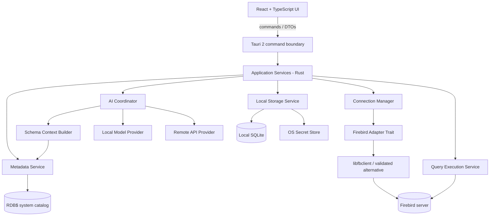

# Spec 02 — Arquitetura de Alto Nível

**Documento de origem:** Seção 5 da especificação técnica
**ADRs relacionadas:** ADR-001 (Tauri 2), ADR-002 (driver Firebird), ADR-003 (SQLite + keyring)

## 1. Diagrama

## 2. Camadas

### Interface (React/TypeScript)
- Exibe estado e solicita operações através de comandos tipados.
- Não acessa diretamente o Firebird, arquivos arbitrários ou segredos.
- Não decide se SQL é seguro; apresenta a avaliação do backend e exige confirmação adequada.

### Fronteira Tauri
- Expõe comandos explicitamente permitidos.
- Valida argumentos, limites, sessão ativa e permissões da operação.
- Aplica escopos mínimos às APIs Tauri; evitar permissões genéricas de filesystem/shell.

### Serviços de aplicação (Rust)
- Orquestram sessões de banco, leitura de catálogo, execução, persistência, segurança e IA.
- Independem da interface para facilitar testes unitários.

### Domínio
- Define modelos e contratos sem depender de Tauri, React ou provedores de IA.
- Contém regras para versão de servidor, normalização de metadados, classificação de
  operações e limites de execução.

### Adaptadores externos
- Adaptador Firebird.
- Adaptadores para provedor local e API remota de IA.
- SQLite, cofre de segredos do SO e logging.

## 3. Stack proposta

| Área | Opção inicial | Observações |
|---|---|---|
| Desktop | Tauri 2 | Binário nativo + frontend web |
| UI | React + TypeScript + Vite | Interface por funcionalidades |
| Editor SQL | CodeMirror 6 | Linguagem Firebird própria; não assumir suporte pronto |
| Grades | TanStack Table + virtualização | Paginação e renderização de resultados grandes |
| Estado UI | Zustand ou Context API | Zustand somente se o estado compartilhar justificar |
| Backend desktop | Rust | Serviços, acesso a banco, limites, persistência |
| Cliente Firebird | `libfbclient.so` dinâmica, se validada | Alternativa decidida após prova de conceito |
| Persistência local | SQLite via crate Rust | Configuração, histórico, descrições locais |
| Segredos | Secret Service/libsecret ou keyring equivalente | Nunca senha em texto puro no SQLite |
| Testes UI | Vitest + Testing Library | Unitários e componentes |
| Testes Rust | `cargo test` | Domínio, serviços, adaptadores simulados |
| Testes de fluxo | Playwright ou equivalente | Caminhos críticos; integração com Tauri |
| Pacotes JS | pnpm | Troca não impacta a arquitetura |

A escolha de editor, driver e bibliotecas deve ser revisada na prova de conceito.
Nenhuma dependência de terceiros é declarada como comprovadamente compatível com
Firebird 2.0 até a execução dos testes de integração.
